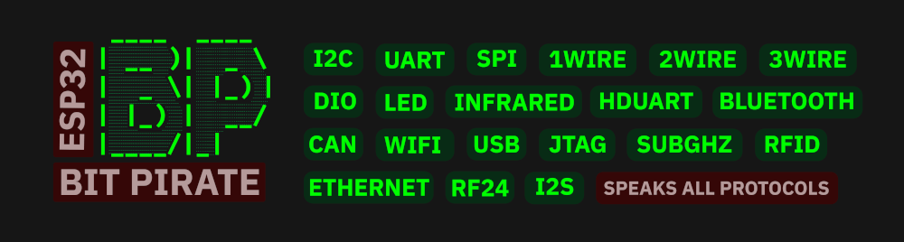
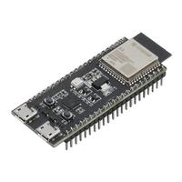
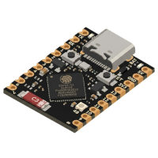
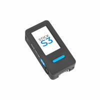
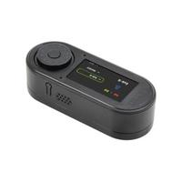
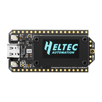
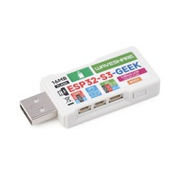

# ⚡ ESP32 OmniBus

[](https://github.com/)

**ESP32 OmniBus** là firmware mã nguồn mở biến vi điều khiển ESP32 / ESP32-S3 của bạn thành một thiết bị phân tích, phát triển và gỡ lỗi đa giao thức (Multi-Protocol Hardware Hacking & Analyzer Tool), lấy cảm hứng từ Bus Pirate huyền thoại.

Hệ thống hỗ trợ lắng nghe (sniffing), truyền dữ liệu, viết kịch bản tự động hóa và tương tác trực tiếp với hàng loạt giao thức phần cứng thông dụng (I2C, SPI, UART, 1-Wire, CAN...) cũng như các giao thức vô tuyến (Wi-Fi, Bluetooth BLE, Sub-GHz, LoRa, RFID...).

---

## 🌟 Điểm nổi bật & Tính năng chính

- **Giao diện Web UI OmniBus Hiện đại:**
  - 🇻🇳 **Hỗ trợ Song ngữ Toàn diện:** Nút chuyển đổi 1 chạm giữa **Tiếng Việt** và **English**.
  - ⚡ **Thanh Lệnh Nhanh (Quick Command Bar):** Thực thi ngay các thao tác thường dùng (`help`, `mode`, `status`, `scan`, `pins`, `i2c`, `spi`, `wifi`, `clear`).
  - 🤖 **Trợ lý OmniBus AI (Omni Assistant):** Tích hợp mô hình Gemini AI, dịch ngôn ngữ tự nhiên tiếng Việt sang tập lệnh phần cứng chính xác kèm hướng dẫn an toàn chân cắm.
  - 📁 **Quản lý Tệp LittleFS Trực quan:** Kéo và thả tải lên (drag & drop), tải xuống và quản lý bộ nhớ flash nội bộ không cần dây cáp.
  - 📊 **Trạng thái Kết nối Trực tiếp:** Đèn báo trạng thái `ONLINE` / `CONNECTING` / `OFFLINE` thời gian thực qua WebSocket.

- **Đa dạng Giao diện Tương tác:**
  - **Web Terminal qua Wi-Fi:** Truy cập từ máy tính, tablet hoặc điện thoại mà không cần cài driver.
  - **USB Serial CLI:** Tốc độ cao, độ trễ cực thấp cho các tác vụ truyền nhận khối dữ liệu lớn.
  - **Chế độ Standalone (Cardputer):** Điều khiển độc lập với màn hình màu và bàn phím tích hợp.

- **Hơn 20 Giao thức & Chế độ Chuyên dụng:**
  - **I2C:** Quét bus (`scan`), nhận diện chip (`identify`), đọc/ghi thanh ghi, bắt gói tin (`sniff`), trích xuất EEPROM.
  - **SPI:** Đọc/ghi Flash ROM, EEPROM 25xx, thẻ nhớ SD Card, giả lập slave.
  - **UART / Half-Duplex UART:** Tự động dò baudrate, đọc/ghi luồng nối tiếp, cầu nối bridge.
  - **1-Wire / 2-Wire / 3-Wire:** Tương tác cảm biến DS18B20, iButton, Smartcard, chip nhớ 93Cx6.
  - **CAN Bus:** Bắt gói và truyền nhận dữ liệu mạng xe hơi/công nghiệp (kết hợp MCP2515 hoặc transceiver).
  - **Wi-Fi & Ethernet:** Phân tích mạng không dây, quét kênh, kiểm thử an ninh mạng.
  - **Bluetooth Low Energy (BLE):** Quét thiết bị, bắt gói, giả lập bàn phím/chuột BLE HID.
  - **Sub-GHz (CC1101):** Phân tích tín hiệu 315/433/868/915 MHz, ghi và phát lại (replay).
  - **LoRa (SX1262):** Truyền nhận dữ liệu khoảng cách xa, kiểm thử Meshtastic.
  - **RFID / NFC (PN532):** Đọc, ghi và sao chép thẻ Mifare, NTAG, FeliCa.
  - **RF24 (nRF24L01):** Quét phổ tần 2.4 GHz, gửi/nhận gói dữ liệu không dây.
  - **Hồng ngoại (Infrared):** Thu phát tín hiệu điều khiển từ xa, hỗ trợ hơn 80 giao thức.
  - **Digital I/O & PWM:** Đo logic, vẽ biểu đồ analog, phân tích chân GPIO (`wizard`).
  - **Addressable LED:** Điều khiển và tạo hiệu ứng cho hơn 50 chuẩn LED ma trận / dải LED.

---

## 🛠️ Danh sách Phần cứng Hỗ trợ

Tất cả các bo mạch sử dụng chip **ESP32-S3** (Flash từ 4MB trở lên) đều có thể cài đặt và sử dụng đầy đủ các tính năng:

| Bo mạch / Thiết bị | Hình ảnh | Mô tả phần cứng |
| :--- | :---: | :--- |
| **ESP32-S3 DevKit (N8, N16R8...)** |  | Hơn 20 chân GPIO tự do, nút nhấn đa năng |
| **ESP32-S3 Zero / Super Mini** |  | Siêu nhỏ gọn, 15 chân GPIO lộ ra ngoài |
| **M5Stack Cardputer / ADV** |  | Màn hình, bàn phím, pin, khe thẻ nhớ SD, cổng Grove |
| **M5StickC S3 / AtomS3** |  | Thiết bị bỏ túi, màn hình màu, mắt thu/phát hồng ngoại |
| **LILYGO T-Embed & T-Embed CC1101** |  | Màn hình tròn/chữ nhật, núm xoay encoder, tích hợp RF CC1101 |
| **Heltec WiFi LoRa 32 V4** |  | Tích hợp sẵn module LoRa SX1262 công suất cao |
| **Waveshare ESP32-S3-GEEK** |  | Dạng USB Dongle tiện lợi, có màn hình LCD và khe thẻ MicroSD |

---

## 🚀 Hướng dẫn Bắt đầu Nhanh

### 1. Nạp Firmware (Flash)
- Kết nối bo mạch ESP32-S3 vào máy tính qua cổng USB.
- Sử dụng các công cụ nạp mã nguồn mở hoặc nạp qua PlatformIO / ESP-IDF / esptool:
  ```bash
  esptool.py --chip esp32s3 write_flash 0x0 firmware.bin
  ```

### 2. Kết nối và Sử dụng
- **Qua USB Serial:** Mở phần mềm terminal bất kỳ (PuTTY, TeraTerm, minicom hoặc trình duyệt hỗ trợ Web Serial) ở tốc độ `115200 baud`.
- **Qua Wi-Fi:** Kết nối vào mạng Wi-Fi do ESP32 phát ra (hoặc mạng nội bộ cùng dải IP), sau đó mở trình duyệt truy cập:
  ```text
  http://192.168.4.1   (hoặc địa chỉ IP được cấp)
  ```

### 3. Thử nghiệm Giao diện Trực tiếp trên Máy tính (Local Demo)
Dự án có sẵn một máy chủ giả lập Python WebSocket hoàn chỉnh giúp kiểm thử toàn bộ giao diện Web UI và tính năng AI ngay trên máy tính mà không cần cắm phần cứng:

```bash
# Di chuyển vào thư mục webui
cd webui

# Khởi động máy chủ demo
python3 demo_server.py
```
Sau đó truy cập: **`http://localhost:8080`** trên trình duyệt của bạn.

---

## 📋 Bảng So sánh Các Giao diện CLI

| Tiêu chí | Web UI (Wi-Fi) | Serial Terminal (USB) | Standalone (Cardputer) |
| :--- | :--- | :--- | :--- |
| **Phương thức** | Trình duyệt Web qua Wi-Fi | Cáp USB Serial | Màn hình + Bàn phím tích hợp |
| **Tiện ích nổi bật** | Song ngữ VN/EN, Trợ lý AI, Quản lý tệp kéo thả | Độ trễ siêu thấp, xử lý lượng dữ liệu lớn | Tiện lợi ngoài thực địa, không cần máy tính |
| **Thiết bị phù hợp** | PC, Laptop, Smartphone, Tablet | Máy tính kỹ thuật viên | Thiết bị cầm tay độc lập |

---

## ⚠️ Cảnh báo An toàn & Miễn trừ Trách nhiệm

> ⚡ **Cảnh báo Điện áp:** Mức logic của ESP32 là **3.3V**. Khi giao tiếp với các thiết bị hoạt động ở mức điện áp 5V hoặc cao hơn, cần sử dụng mạch chuyển mức logic (Level Shifter) để tránh làm hỏng vi điều khiển.
>
> 🔒 **Mục đích Sử dụng:** Firmware này được phát triển phục vụ cho công tác **nghiên cứu, học tập, chẩn đoán kỹ thuật và kiểm thử an ninh hợp pháp**.
> - Không sử dụng thiết bị để can thiệp trái phép vào hệ thống phần cứng của người khác.
> - Nghiêm cấm phát các tín hiệu vô tuyến (Sub-GHz, Wi-Fi deauth...) trái quy định của pháp luật hiện hành.
> - Tác giả không chịu trách nhiệm đối với bất kỳ hành vi lạm dụng hoặc thiệt hại nào do việc sử dụng phần mềm sai mục đích.

---

## 📄 Bản quyền & Đóng góp

Dự án được phân phối dưới giấy phép mã nguồn mở. Mọi đóng góp về mã nguồn, sửa lỗi hoặc dịch thuật đều được chào đón nồng nhiệt thông qua GitHub Pull Request.
